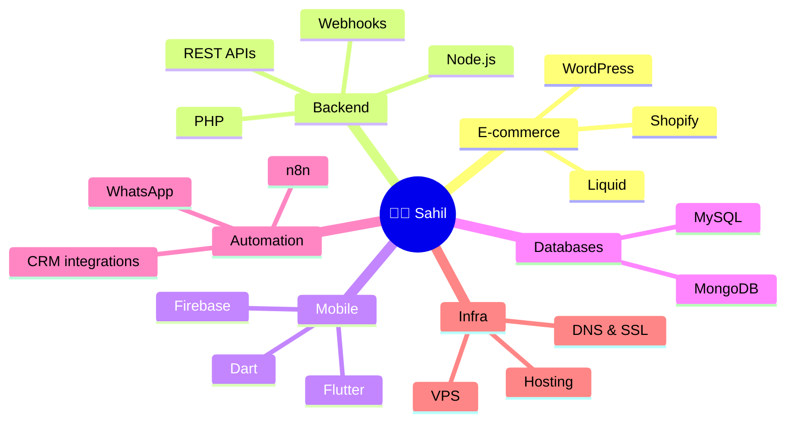

<!-- ╔══════════════════════════════════════════════════════════════╗ -->
<!-- ║   ✦  SAHIL BISHNOI  •  GITHUB PROFILE README  ✦             ║ -->
<!-- ╚══════════════════════════════════════════════════════════════╝ -->

<!-- ═══════════════ HERO BANNER ═══════════════ -->
<div align="center">

  

</div>

<!-- ═══════════════ TITLE ═══════════════ -->
<div align="center">

  <h1>
    Hey there, I'm Sahil
    
    
  </h1>

</div>

<!-- ═══════════════ TYPING ANIMATION ═══════════════ -->
<div align="center">

  <a href="https://github.com/sahilbishnoidev">
    
  </a>

</div>

<br/>

<!-- ═══════════════ BADGES ═══════════════ -->
<div align="center">

  
  
  
  <a href="https://www.linkedin.com/in/sahil-bishnoi29/">
    
  </a>

</div>

<!-- ═══════════════ DIVIDER ═══════════════ -->


<!-- ═══════════════ ABOUT ME ═══════════════ -->
##  &nbsp;About Me

<table>
<tr>
<td width="60%" valign="top">

```javascript
const sahil = {
  role:       "Lead Software Engineer @ Kloud Quantum",
  location:   "Hisar, Haryana, India 🇮🇳",
  education:  "B.Tech CSE — CDLU, Sirsa (2021–2025)",

  code:       ["JavaScript", "PHP", "Dart", "Liquid"],

  stack: {
    frontend:   ["HTML5", "CSS3", "Bootstrap", "JavaScript"],
    backend:    ["Node.js", "PHP", "REST APIs", "Webhooks"],
    ecommerce:  ["Shopify", "Liquid", "WordPress"],
    mobile:     ["Flutter", "Dart", "Firebase"],
    database:   ["MySQL", "MongoDB", "Firebase"],
    automation: ["n8n", "WhatsApp", "Third-party APIs"],
    infra:      ["VPS", "DNS", "SSL", "Hosting"]
  },

  shipped:    "11+ live websites • client apps on Play Store & App Store",
  loves:      "Problems that go beyond the UI — systems, logic & automation",
  motto:      "Idea → Requirement → Deployed product."
};
```

</td>
<td width="40%" valign="top" align="center">

  

  <br/>
  <br/>

  <a href="https://www.linkedin.com/in/sahil-bishnoi29/">
    
  </a>

</td>
</tr>
</table>

<!-- ═══════════════ DIVIDER ═══════════════ -->


<!-- ═══════════════ WHAT I DO ═══════════════ -->
##  &nbsp;What I Do

<table>
<tr>
<td width="50%" valign="top">

#### 🛒 &nbsp;E-commerce
- **Shopify** stores & custom **Liquid** sections
- Payment gateway & shipping platform integrations
- Custom **WordPress / PHP** builds — beyond page builders

</td>
<td width="50%" valign="top">

#### 📱 &nbsp;Web & Mobile Apps
- Full-stack web applications, end to end
- **Flutter** apps shipped to Play Store & App Store
- Custom **admin panels** & business management systems

</td>
</tr>
<tr>
<td width="50%" valign="top">

#### ⚙️ &nbsp;APIs & Automation
- **REST APIs**, webhooks & third-party integrations
- **n8n** workflows & WhatsApp / CRM automations
- Business logic that runs quietly in the background

</td>
<td width="50%" valign="top">

#### 🚀 &nbsp;Deployment & Infra
- Hosting, domains, **DNS & SSL**
- VPS / server setup and troubleshooting
- Performance optimisation & ongoing maintenance

</td>
</tr>
</table>

<!-- ═══════════════ DIVIDER ═══════════════ -->


<!-- ═══════════════ FLAGSHIP PROJECT ═══════════════ -->
##  &nbsp;Flagship Project — Prexa Labs

<div align="center">

### 💬 [Prexa Labs](https://prexalabs.in)
**WhatsApp, Instagram & Messenger in one smart inbox — automation & commerce for every business**

[](https://prexalabs.in)
[](https://app.prexalabs.in)


</div>

> A **multi-tenant SaaS** I designed and built end to end. It lets e-commerce stores, clinics, travel agencies, real-estate and service businesses run their customer conversations, marketing and order verification on official Meta APIs — from a single dashboard.

<table>
<tr>
<td width="50%" valign="top">

**✨ What it does**
- 📥 **2-way team inbox** — WhatsApp, Instagram DMs & Messenger in one place, with assignment & team roles
- 🤖 **AI chatbots** & a visual automation-flow builder that answer 24×7
- 🛒 **Shopify & WooCommerce** — COD order verification, anti-RTO buttons & cart recovery
- 📣 **Broadcast campaigns**, WhatsApp templates, contacts & audience segments
- 🧩 **Website chat widget** + a WordPress / WooCommerce plugin
- 📊 Analytics, billing & an admin panel for managing every tenant

</td>
<td width="50%" valign="top">

**🏗️ How it's built**
- **Frontend:** Next.js 16 · React 19 · Tailwind CSS · Zustand · Clerk auth
- **Backend:** 100% serverless on **Cloudflare Workers**
- **Data:** Cloudflare **D1** (SQL) + **KV**
- **Messaging:** Meta **WhatsApp Cloud API**, Instagram & Messenger
- **Integrations:** Shopify, WooCommerce, webhooks, multiple AI providers
- **Multi-tenancy:** isolated credentials & conversation history per business

</td>
</tr>
</table>

<div align="center">


<sub>🔒 The codebase is private — happy to walk through the architecture or give a live demo.</sub>

</div>

<!-- ═══════════════ DIVIDER ═══════════════ -->


<!-- ═══════════════ HIGHLIGHTS ═══════════════ -->
##  &nbsp;Work Highlights

<table>
<tr>
<td width="50%" valign="top">

### 💬 Shopify COD Verification on WhatsApp
> New COD orders trigger an automated WhatsApp confirmation. The workflow handles confirm / cancel replies, retries unanswered requests and flags orders for manual follow-up — so only verified orders move to shipping.

`Shopify` `Webhooks` `WhatsApp` `Automation`

</td>
<td width="50%" valign="top">

### 🌐 11+ Live Websites
> E-commerce stores, business websites and custom web applications — custom-coded in PHP and modern web tech, plus WordPress projects with real custom PHP development.

`PHP` `WordPress` `Shopify` `JavaScript`

</td>
</tr>
<tr>
<td width="50%" valign="top">

### 📱 Client Mobile App — Live on Both Stores
> Took a real client app from development to production release, now live on the **Google Play Store** and **Apple App Store**.

`Flutter` `Dart` `Firebase`

</td>
<td width="50%" valign="top">

### 🧩 Custom Admin Panels
> Tailored admin panels and backend workflows that let clients manage content, business data and day-to-day operations themselves.

`PHP` `Node.js` `MySQL` `MongoDB`

</td>
</tr>
</table>

<!-- ═══════════════ DIVIDER ═══════════════ -->


<!-- ═══════════════ TECH STACK ═══════════════ -->
##  &nbsp;Tech Stack

<div align="center">

  <a href="https://skillicons.dev">
    
  </a>

  <br/><br/>

  
  
  
  
  
  

</div>

<br/>

<!-- ═══════════════ MIND MAP ═══════════════ -->
<details>
<summary><b>🧠 &nbsp;See my skills as a mind map</b></summary>



</details>

<!-- ═══════════════ DIVIDER ═══════════════ -->


<!-- ═══════════════ GITHUB STATS ═══════════════ -->
##  &nbsp;GitHub Analytics

<div align="center">

  
  

</div>

<!-- ═══════════════ DIVIDER ═══════════════ -->


<!-- ═══════════════ CONNECT ═══════════════ -->
##  &nbsp;Let's Work Together

<div align="center">

**Got a business problem that needs a website, an app, an integration or an automation?**
<br/>
I'd love to hear about it.

<br/>

<a href="https://www.linkedin.com/in/sahil-bishnoi29/">
  
</a>
<a href="https://github.com/sahilbishnoidev">
  
</a>

</div>

<!-- ═══════════════ FOOTER ═══════════════ -->

